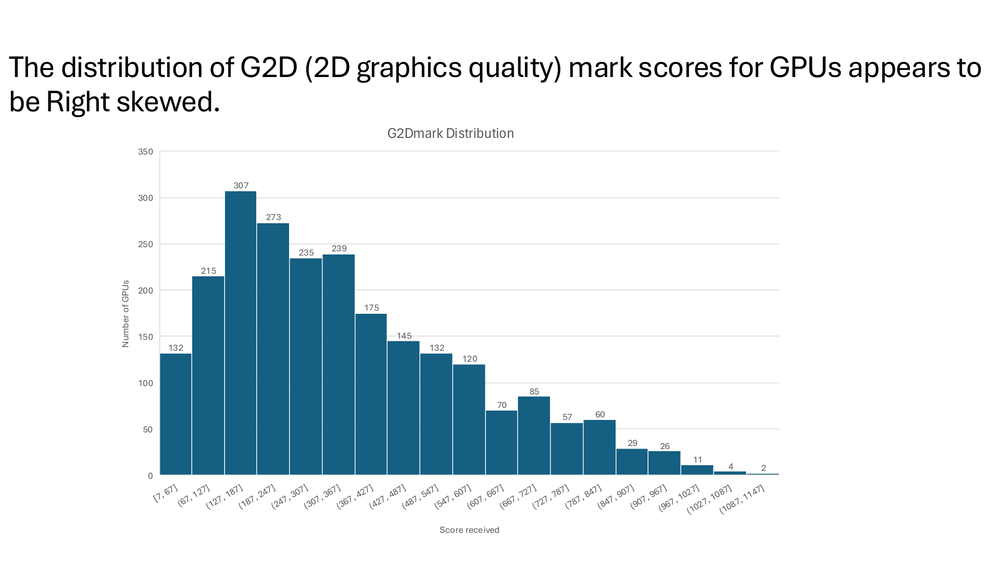
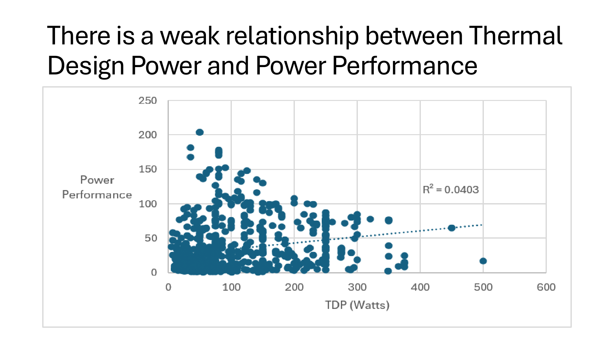
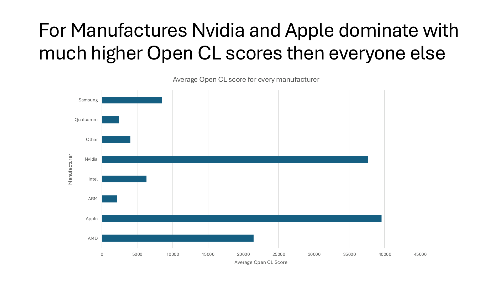
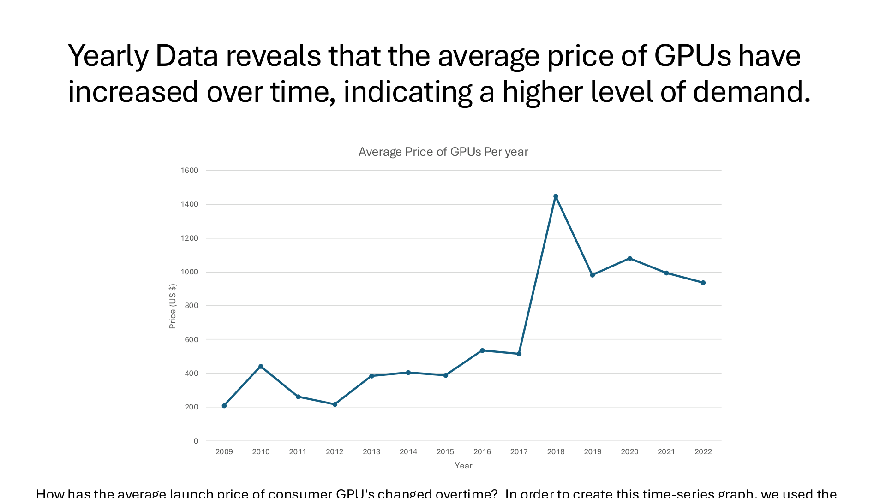

## Team contributors

This project was completed by **Christopher Espina, Hudson Wood, David Williams, and Israel Klebanoff**. Portfolio URLs must be added once the team members provide their confirmed addresses; they were not included in the source materials.

## Dataset and approach

Our team examined GPU data beginning in 2009, using the metrics reported in our slide deck: **G2DMark**, **thermal design power (TDP)**, **power performance**, **manufacturer**, **OpenCL benchmark**, **GPU price**, and **year**. Using Excel, we organized and summarized these attributes to communicate findings through four assertion–evidence slides: one histogram, one scatter plot, one bar chart, and one time-series chart. The original spreadsheet and dataset URL were not provided with the slides, so exact data cleaning steps cannot be independently verified.

## 1. G2DMark scores show a right-skewed distribution

**Question:** How are GPUs distributed across G2DMark (2D graphics quality) scores?

**Why we asked:** This shows whether 2D graphics capability is fairly evenly distributed or whether many GPUs fall into lower score ranges with only a few achieving high scores.

**Excel analysis:** We grouped numeric G2DMark scores into intervals and counted the GPUs in each interval. The resulting histogram plots GPU count against score range. The original slide displays 307 GPUs in one of the lower-scoring bins, while the highest score bins contain only a handful.

**Slide development:** The team used a frequency histogram with score intervals on the horizontal axis, GPU counts on the vertical axis, and a headline that states the observed right skew.

{.slide-image}

## 2. TDP has a weak linear relationship with power performance

**Question:** How strongly is thermal design power (TDP) associated with GPU power-performance score?

**Why we asked:** Power requirements matter for system design and operating costs. We wanted to see whether higher TDP by itself helps predict the power-performance metric.

**Excel analysis:** We plotted individual GPUs using TDP (watts) on the horizontal axis and power-performance score on the vertical axis. We added a linear trendline and displayed its coefficient of determination, **R² = 0.0403**, indicating the fitted line explains only about 4% of the observed variation in the score.

**Slide development:** We kept individual observations visible as points, included the axes and trendline, and used an assertion headline describing the weak relationship.

{.slide-image}

## 3. Nvidia and Apple lead manufacturer OpenCL averages in this dataset

**Question:** How do average OpenCL benchmark scores compare among GPU manufacturers?

**Why we asked:** Comparing average scores across manufacturers can reveal broad differences in the GPU models represented in the dataset.

**Excel analysis:** We grouped GPUs by manufacturer and compared the average OpenCL score for AMD, Apple, ARM, Intel, Nvidia, Other, Qualcomm, and Samsung. We presented the resulting manufacturer averages as a horizontal bar chart.

**Slide development:** A horizontal bar layout keeps manufacturer names readable, and an assertion headline highlights that Apple and Nvidia have the highest plotted averages in this dataset. It is not a claim about all GPUs in the market.

{.slide-image}

## 4. Average GPU prices rise overall between 2009 and 2022

**Question:** How did the average listed GPU price change by year between 2009 and 2022?

**Why we asked:** Price is an important consideration when comparing GPU products, and a time series helps reveal changes across release years.

**Excel analysis:** We grouped the price information by calendar year and displayed the average GPU price for each year from 2009 through 2022. Year appears on the horizontal axis and average price in U.S. dollars on the vertical axis.

**Slide development:** The line graph makes annual changes visible, while the assertion headline draws attention to the overall upward trend. The slide suggests increasing demand as an explanation, but the displayed prices alone do not establish what caused the changes.

{.slide-image}

## Project conclusion

The four graphs compare the shape of the GPU benchmark distribution, the weak association between TDP and power-performance score, differences in average OpenCL scores across manufacturers, and changing average prices over time. Each slide uses an assertion–evidence layout so the conclusion appears prominently and the chart provides the supporting evidence.

*Original figures: Data Visualization for GPUs Since 2009, team slide deck supplied for this project. Dataset URL and teammate portfolio links still need to be supplied for a completely documented submission.*
