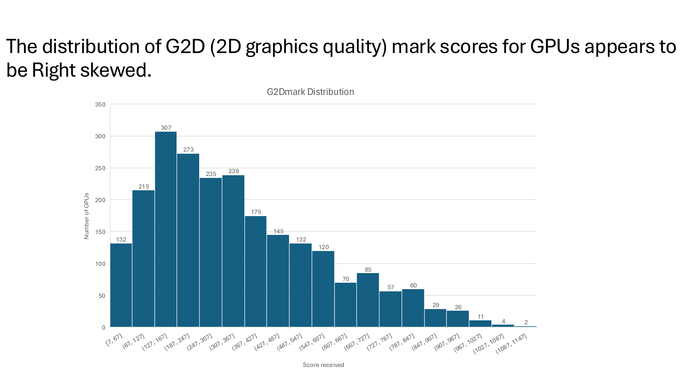

## Data Visualization for GPUs Since 2009

**INEG 21003 · Fall 2026 · Team Project**

Christopher Espina, Hudson Wood, David Williams, and Israel Klebanoff analyzed GPU benchmark scores, power efficiency, manufacturer performance, and pricing across calendar years.

[View all four original charts and our analysis](data-visualization.qmd)

{width=75%}
